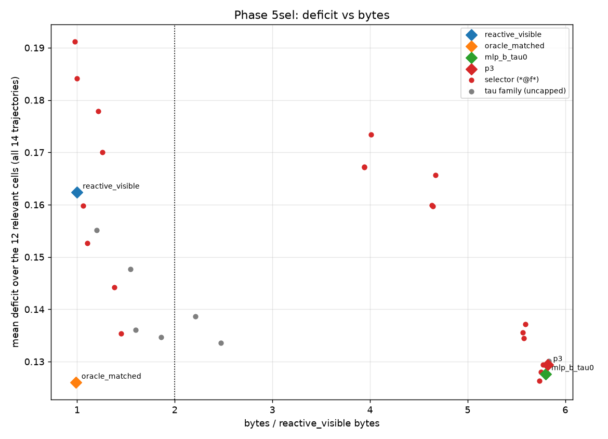
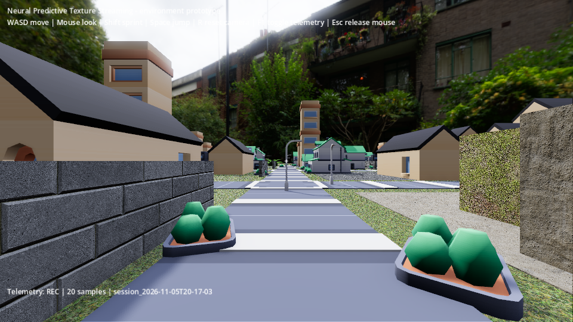
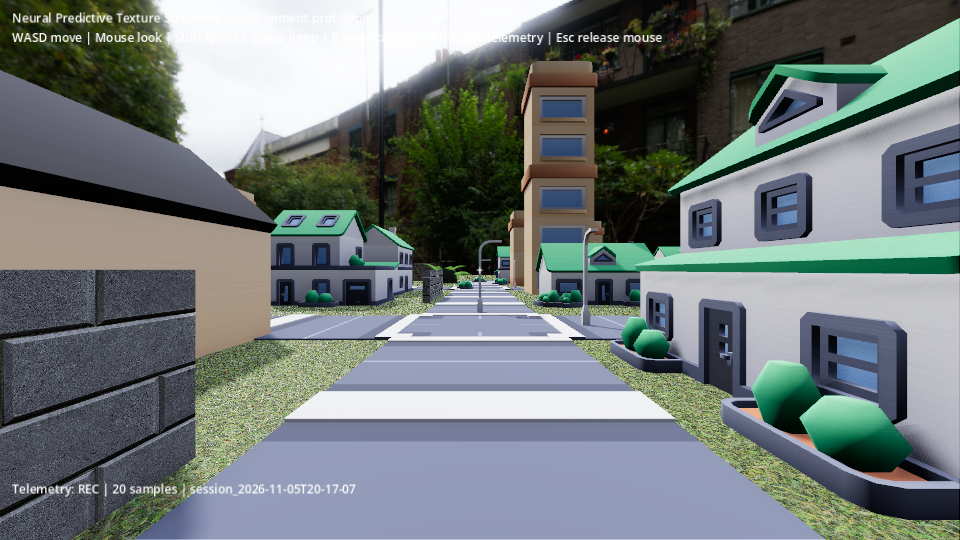
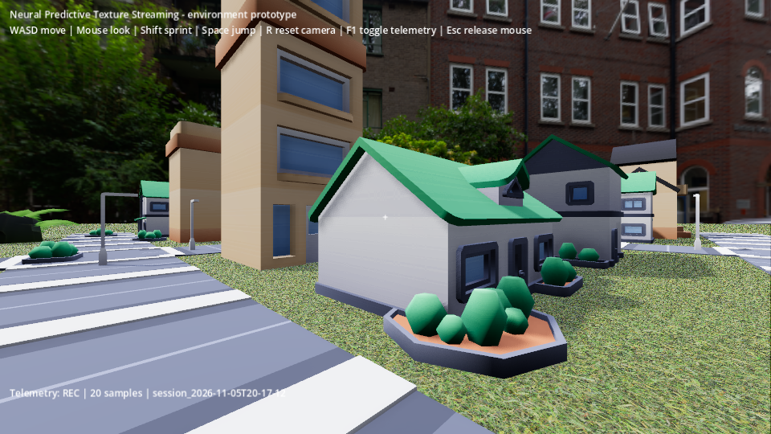
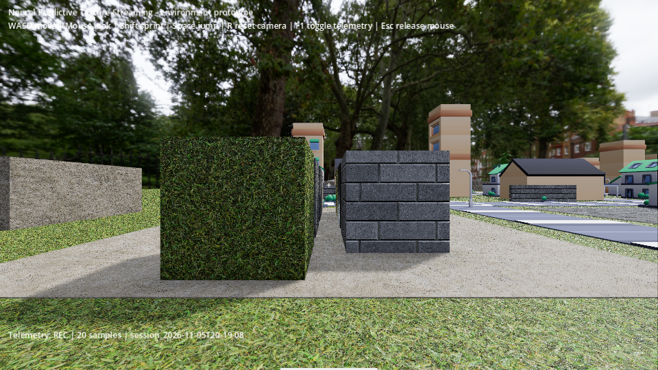
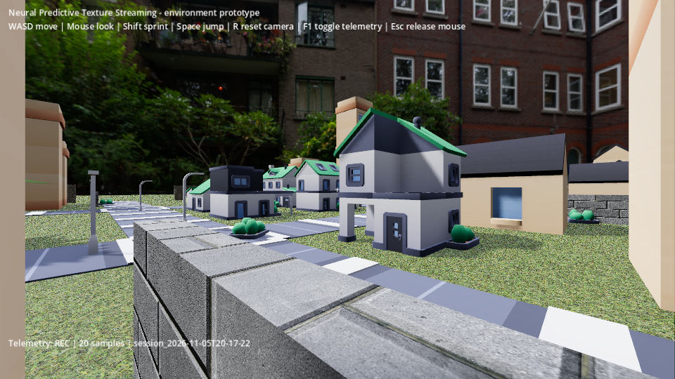
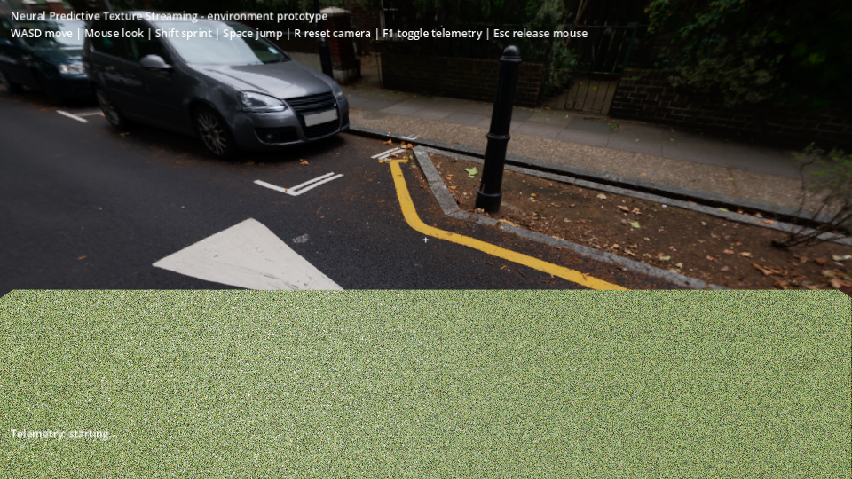
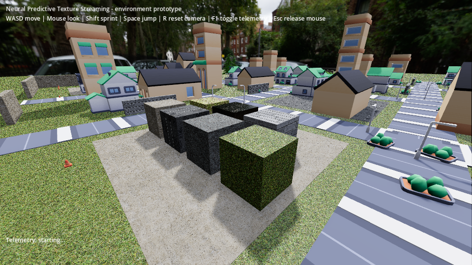

# Neural Predictive Texture Streaming — Final Project Report

## 1. Abstract and headline results

This project asked whether a learned predictor can reduce texture pop-in in a real-time 3D city when both memory and the load path are constrained. The answer is yes, within a specific and now measured regime: predictive prefetching helps when latency is the binding constraint, the geometric heuristic is a strong opponent on frustum prediction, and the learned MLP's distinct value is occlusion-aware ranking and graceful behaviour under a threshold. The full stack was taken through telemetry, labels, baselines, a small MLP, an offline simulator, an in-engine runtime, and a complete live side-by-side demo.

- **Prediction has a bounded latency band, not a universal advantage.** In the full 268-object simulator, 12 of 84 cells are prediction-relevant (`best_reactive − oracle_matched >= 0.02`); the crossover latency is 0.3 s at load-time scales 0.25 and 1, 0.5 s at scale 4, and "none in range" at scale 16, for both `heuristic_occ_tau0` and `mlp_b_tau0` over all 14 trajectories. (docs/phase-4bplus-report.md; sim/results_4bplus/summary.md)
- **A calibrated threshold gets most of the benefit at far less traffic.** Over the same 12 full-268-object cells and all 14 trajectories, `mlp_b_tau0.5` has deficit 0.1361 at 1.6x the bytes of `reactive_visible` (versus 0.1277 at 5.8x for `mlp_b_tau0`), and helps in 12 of 12 relevant cells. On the held-out split-v1 test partition (t01, t03, t04, t06), its deficit is 0.1682 at 1.44x bytes. The pre-declared cost-blind rule chose tau = 0; tau = 0.5 is a post-hoc operating point read from the published curve. (docs/phase-4bplus-report.md; docs/phase-5sel.md; sim/results_5sel/summary.md)
- **The learned model matches the strong heuristic at full recall and is better once selection is required.** In leave-trajectory-out out-of-fold (LOTO OOF) evaluation over all 14 trajectories, primary subset, snap-yaw rows excluded, the frozen heuristic's pooled frustum PR-AUC at 0.5 s is 0.7055 against 0.5318 for MLP variant b, while on occlusion at 1.0 s the MLP reaches 0.3867 against 0.2252 for the heuristic. In the 4b+ simulator at tau = 0, the paired bootstrap CI favours `mlp_b` in 5 of 12 cells, is indistinguishable in 7, and never favours the heuristic; at tau = 0.5 it favours `mlp_b` in 12 of 12. (docs/phase-3b-report.md; docs/phase-4bplus-report.md)
- **Occlusion culling dominates the memory-tight regime.** In the 268-object simulator at 10–50% of peak working set, mean deficit falls from 0.3354 (`reactive_frustum`) to 0.2787 (`reactive_visible`), an 88.9% share of the reactive-to-oracle gap; the entire prediction stack adds a further 0.0110, about 5% relative, over all 18 configurations and 14 trajectories. (docs/phase-4a-report.md)
- **The engine matches the simulator, and the demo is complete.** On the 53-object in-engine scope (`sim/config_5engine.yaml`), the maximum normalized deficit difference over 42 engine/simulator cells is 4.29e-7; the live demo reproduces the engine `simulate()` deficit to 0.000000000 for every policy on t06_look_around. The measured full-texture upload has a 23.1 ms main-thread hitch, and the shipped dual-pane demo runs at 59.8 FPS in a 1920×1080 borderless fullscreen window. (docs/phase-5-results.md)
- **A byte cap and a ranking objective confirm that the threshold is the right control.** In the pre-declared Phase 5sel study on the 12 full-268-object prediction-relevant cells, P3 ranks better on validation NDCG@10 (0.5906 listwise versus 0.5235 hinge) but is equivalent at the simulator level (deficit 0.1294 at 5.82x bytes versus 0.1277 at 5.80x for `mlp_b_tau0` over all 14; CI [-0.0003, +0.0054]); no candidate improved on the `mlp_b_tau0.5` frontier. (docs/phase-5sel-protocol.md; docs/phase-5sel.md; sim/results_5sel/summary.md)

## 2. Problem and motivation

A texture that becomes visible before its full-resolution data has arrived appears as a low-resolution placeholder and then pops. Two resources can cause that delay: resident memory, which limits how many full textures can be kept, and the load path, which determines how early a request must be issued. A reactive policy cannot ask for an object before it is visible; a predictive policy can, but speculative requests consume bandwidth and can displace useful residents.

The project therefore studies a single decision: given camera motion, scene geometry and current visibility, which objects should receive a full-texture request now? It is evaluated at three levels — classification/ranking metrics on future-demand labels, a trace-driven streaming simulator with explicit memory and transport rules, and the same policy stack running inside Godot with real texture swaps. Each level narrows the claim rather than replacing it. The simulator makes the trade-off auditable; the engine establishes that the policy and metrics survive contact with a renderer; the demo makes the result inspectable at the moment of pop-in.

## 3. System and environment

The environment is a procedurally generated Godot 4.7 city of **268 objects** with **14 scripted trajectories**, generated under environment seed **20260501** (docs/phase-4a-report.md; docs/phase-4bplus-report.md). Sampling is at **0.1 s** (10 Hz; 6 physics ticks at 60 Hz), with 0.5 s and 1.0 s prediction horizons corresponding to 5 and 10 future samples (docs/phase-3a-report.md). The full dataset contains **2,840 samples**, **2,531** samples that emitted at least one candidate row, **309** empty samples, and **188,469** label rows (docs/phase-3a1-report.md).

The streaming test rig is Godot **4.7.2.stable** (Forward+), NVIDIA GeForce MX550 (NVK TU117), **1280×720**, `--fixed-fps 60`, 10 Hz sampling (docs/phase-5-results.md).

Trajectory roles are fixed by `experimental_split_v1` (docs/phase-3a1-report.md):

| Role | Trajectories | Use in this report |
|---|---|---|
| Train (7) | t02, t09, t10, t11, t12, t13, t14 | Model fits; t09, t13 and t14 contain the documented yaw snaps and are excluded from headline metrics by row masking. |
| Validation (3) | t05, t07, t08 | Threshold, loss, allowance-factor and tau selection; never used for the headline test score. |
| Test (4) | t01, t03, t04, t06 | Scored once after choices were frozen; t06 is the trajectory shown in the demo. |

For all LOTO results, every trajectory's score comes from the fold that held that trajectory out; no scored trajectory supplied its own model training rows (docs/phase-3b-report.md; docs/phase-4a-report.md). The exported demo model was trained on split v1's train partition and early-stopped on validation; it has never seen the test partition (docs/phase-3b-report.md). The demo's `mlp_b` policy does not run that model live; it replays recorded LOTO scores (docs/phase-5-results.md).

## 4. Dataset, labels, and two documented data defects

Labels are object-by-sample rows built from the camera position at time *t*, static object bounds and a fixed **25 m** candidate radius; that selection is causal and uses no future field, verified on **2,531** samples with **0** mismatches (docs/phase-3a-report.md). The feature pipeline uses **65** allow-listed columns, and future fields, object IDs, trajectory IDs and absolute pose are rejected by construction and by tests (docs/phase-3a-report.md). Targets are frustum demand, occlusion-aware demand as a tri-state label, and required resolution; unknown occlusion is never treated as negative (docs/phase-3a-report.md).

Two data defects were found and documented rather than silently repaired:

- **Quaternion short-arc defect.** The recorder computes an axis-angle difference without choosing the shorter arc, so when the difference lands on the −q representation it reports roughly `2*pi - theta`. On `t06_look_around` sample 33 a genuine **18 deg/s** rotation is recorded as **3582.5 deg/s**, producing a **36,005 deg/s²** acceleration spike. The extent is **6 of 2,826** sample pairs (**0.21%**) across **4** trajectories; the feature pipeline recomputes angular velocity from orientations with the short-arc correction, and the recorder itself is unchanged (docs/phase-3a-report.md; docs/known-issues.md).
- **Camera yaw snaps at waypoint boundaries.** A `control` segment assigns heading absolutely with `yaw_from = 0.0` after a `waypoint` segment left a different heading. There are **3** snaps: t09 sample 140 (**180.00 deg**), t13 sample 120 (**90.00 deg**) and t14 sample 100 (**80.20 deg**), with no position change at any of them. Every newly-visible event in t09 (**175**) and t13 (**65**) lies within ±10 samples of a snap, and **65 of 100** Phase 2.5 test positives came from t13 (docs/phase-3a1-report.md; docs/known-issues.md).

Both defects remain in the recorded telemetry by scope decision: no dataset was regenerated. Their affected rows are masked from training loss and headline metrics where the protocol requires it, and the evaluation sidecar records the flags per `(trajectory, sample)` (docs/phase-3a1-report.md; docs/phase-5-results.md).

## 5. Methodological rigor

The project's strongest methodological result is that it corrected its own headline. Phase 3a reported a primary-subset, 0.5 s frustum PR-AUC of **0.1894** on the Phase 2.5 test set (t11, t13, t03; **100** positives). Phase 3a.1 showed that **65** of those positives came from t13 and all were snap-affected: without t13, pooled AP is **0.9044** on **35** positives; excluding snap-affected rows gives **0.8556**; t13 alone gives **0.0099**. Across all 14 trajectories with snap rows excluded, recall rises from **0.5763** to **0.6483**, F1 from **0.6476** to **0.7030**, and PR-AUC from **0.5972** to **0.7055** (docs/phase-3a1-report.md). The revised claim is about *motion-driven* visibility change; snap-driven reveals are generator artefacts and are not treated as prediction difficulty.

That correction shaped the rest of the protocol, and every later decision was declared before its numbers were read:

- Phase 3a tuned **300** combinations on the Phase 2.5 validation partition only, with **0** test rows scored during selection; the 7 grouped LOTO folds use seed **20261105**, with fold *i* holding group *i* out as test and group *i+1* as validation (docs/phase-3a-report.md).
- Phase 4a declared its grid in `sim/config.yaml` before the sweep: **3 budgets × 3 size multipliers × 2 latencies × 7 policies = 126 runs** over **14** trajectories, **1,764** trajectory replays (docs/phase-4a-report.md).
- Phase 4b fixed its three decision rules before the sweep: prediction-relevant gap `>= 0.02`, recovered fraction `>= 0.25`, and wins on `>= 10` of 14 trajectories (docs/phase-4b-report.md).
- Phase 4b+ fixed its five rules before the sweep, including a **95% bootstrap CI** over trajectories (**1,000** resamples, seed **20260501**) with `best_reactive` recomputed inside each resample, and a tau rule that minimizes validation deficit with ties within **0.002** broken toward the lower tau (docs/phase-4bplus-report.md).
- Phase 5sel was written before any Phase 5sel number was computed: the 12 cells, selector, P3 training target, losses, `f` grid and two-clause success rule are frozen in docs/phase-5sel-protocol.md.

Bootstrap CIs are reported as intervals over trajectories, not over the world; LOTO means every trajectory is scored by a model that did not train on it; split v1's test partition (t01, t03, t04, t06) is scored once, after selection. This is the basis on which the report treats null results as scoped findings rather than as uncertainty about the design.

## 6. MLP versus the frozen heuristic

The learned stack is a small dense network, `Linear(65→128) → ReLU → Dropout(0.1) → Linear(128→64) → ReLU → Dropout(0.1) → Linear(64→4)`, with **17,092** parameters in exported variant b (docs/phase-3b-report.md). Variant b adds the frozen frustum-tuned heuristic score as a 66th input, so the model uses the geometric predictor as a feature rather than re-deriving it. CPU inference costs **0.140 ± 0.003 ms** for a batch of **300** candidates (4 threads, 50 repeats) (docs/phase-3b-report.md).

All numbers below are LOTO OOF over **all 14 trajectories**, pooled primary subset with snap-yaw rows excluded; each trajectory's score came from its held-out fold (docs/phase-3b-report.md):

| Output | Frozen heuristic | Best learned result | Reading |
|---|---|---|---|
| `frustum_0_5` | **0.7055** | 0.5318 ± 0.021 (variant b) | Heuristic wins clearly; no claim of MLP superiority. |
| `frustum_1_0` | **0.5685** | 0.5407 ± 0.013 (variant b) | Near parity. |
| `occlusion_0_5` | 0.2261 | 0.3529 ± 0.013 (variant c, HistGradientBoosting); MLP b 0.3458 ± 0.017 | Learned models win where the heuristic has no real model. |
| `occlusion_1_0` | 0.2252 | 0.4259 ± 0.004 (variant c); MLP b 0.3867 ± 0.013 | Learned models win clearly. |

(docs/phase-3b-report.md)

At the per-trajectory level on `frustum_0_5`, variant b improves **2 of 7** trajectories with positives and is worse on **5**; on `occlusion_0_5` it improves **10 of 13** and is worse on **3** (docs/phase-3b-report.md). Removing the 20 causal-history columns slightly helps (variant a_k0: **0.4872** versus a's **0.4632** at 0.5 s), which the report reads as evidence that this MLP is under-fitting rather than that history is useless (docs/phase-3b-report.md).

The simulator gives the deployment version of the same comparison. In the 12 prediction-relevant cells of the **268-object** 4b+ grid, at tau = 0 over all 14 trajectories, `mlp_b` is reliably better than `heuristic_occ` in **5** cells, indistinguishable in **7**, and never worse; at tau = 0.5 it is better in **12** (docs/phase-4bplus-report.md). Thresholding costs `mlp_b` **0.0084** mean deficit but costs `heuristic_occ` **0.0250**, even though their high-score row shares are similar (**23.8%** and **19.0%** above 0.5) (docs/phase-4bplus-report.md). This is the precise learned advantage: not full-recall accuracy, but occlusion-aware targeting that survives being selective (docs/phase-4bplus-report.md).

## 7. Streaming simulator

All numbers in this section are from the **full 268-object offline simulator**, over **14 trajectories**, with LOTO OOF model scores; they are not comparable to the 53-object engine numbers in section 8.

### 7.1 Memory-tight regime (4a)

With budgets of 10–50% of peak working set at 200 MB/s and 0.1–0.5 s latency, memory is the binding constraint. Mean deficit over all **18** configurations falls from **0.3354** (`reactive_frustum`) to **0.2787** with occlusion culling, then to **0.2677** with the entire prediction stack; the specified oracle is **0.2733**. Culling therefore captures **88.9%** of the reactive-to-oracle gap and the predictors add roughly **5% relative** (docs/phase-4a-report.md). The frustum heuristic used as-is recovers **−8.1%** of the gap and is worse than `reactive_visible` in **0 of 18** configurations, because it spends bandwidth on objects the player cannot see; the occlusion-tuned heuristic and `mlp_b` each beat `reactive_visible` in **15 of 18** (docs/phase-4a-report.md). Asset weight dominates: mean deficit over deployable policies is **0.1924** at 1x, **0.2353** at 4x and **0.4538** at 16x, against about **0.011** for the whole prediction stack (docs/phase-4a-report.md).

### 7.2 Latency-bound regime (4b)

With budgets of 100–300% and loads of 0.1–1.0 s at 50/200 MB/s, **10 of 54** declared configurations are prediction-relevant, **9** of them at 1.0 s latency, and both `heuristic_occ` and `mlp_b` satisfy the pre-declared help rule in all **10** (median recovered fractions **+94.8%** and **+98.7%**) (docs/phase-4b-report.md). Mean `reactive_visible` deficit is **0.2892** at the swept budgets and **0.2872** with infinite budget: **99%** of the deficit survives unlimited memory (docs/phase-4b-report.md). The declared grid is not 54 independent experiments — size and bandwidth enter only through their ratio, so there are **36** distinct cells and **7** distinct relevant cells — and the help rate is therefore **7/7** in distinct terms (docs/phase-4b-report.md). The cost side is real: over the 10 relevant configurations, `mlp_b` streams **266.5 GB** and wastes **11,908** prefetches against **93.5 GB** and **3,277** for `reactive_visible` (docs/phase-4b-report.md).

### 7.3 Crossover map and byte cost (4b+)

Phase 4b+ holds size at 1x and sweeps four independent load-time scales, giving **84** configurations and **12** prediction-relevant cells (docs/phase-4bplus-report.md):

| Load-time scale | Effective bandwidth | `heuristic_occ_tau0` crossover | `mlp_b_tau0` crossover |
|---|---|---|---|
| 0.25 | 800 MB/s | 0.3 s | 0.3 s |
| 1 | 200 MB/s | 0.3 s | 0.3 s |
| 4 | 50 MB/s | 0.5 s | 0.5 s |
| 16 | 12.5 MB/s | none in range | none in range |

(docs/phase-4bplus-report.md; sim/results_4bplus/summary.md)

The crossover is the smallest latency at which the policy helps in at least one of the three budgets. Headroom shrinks with memory: relevant cells are **10** at 100% budget, **2** at 150% and **0** at 300%, with mean gaps **+0.0148**, **+0.0066** and **+0.0030** respectively (docs/phase-4bplus-report.md).

Over the 12 relevant cells and all 14 trajectories, the trade-off is (docs/phase-4bplus-report.md; sim/results_4bplus/summary.md):

| Policy | Deficit | Bytes loaded | Bytes vs `reactive_visible` | Wasted prefetches |
|---|---|---|---|---|
| `reactive_visible` | 0.1624 | 61.6 GB | 1.0x | 3320 |
| `oracle_matched` (reference) | **0.1260** | **60.9 GB** | **1.0x** | 2662 |
| `mlp_b_tau0` | 0.1277 | 357.5 GB | 5.8x | 21315 |
| `heuristic_occ_tau0` | 0.1301 | 359.5 GB | 5.8x | 19717 |
| `mlp_b_tau0.5` | 0.1361 | 98.4 GB | 1.6x | 6071 |
| `heuristic_occ_tau0.5` | 0.1551 | 74.1 GB | 1.2x | 4713 |

`mlp_b_tau0` matches the `oracle_matched` deficit at **5.8x** the bytes of reactive culling, while the oracle uses fewer bytes than the baseline; full-recall prediction closes the gap by requesting almost everything early (docs/phase-4bplus-report.md). The threshold curve moves the operating point onto a usable part of that trade:

| `mlp_b` tau | Deficit (all 14) | Validation deficit | Bytes loaded (GB) | Wasted prefetches |
|---|---|---|---|---|
| 0 | 0.1277 | 0.0824 | 357.49 | 21315 |
| 0.1 | 0.1336 | 0.1061 | 152.43 | 9040 |
| 0.3 | 0.1346 | 0.1080 | 114.64 | 7225 |
| 0.5 | 0.1361 | 0.1122 | 98.43 | 6071 |

(sim/results_4bplus/summary.md)

Moving `mlp_b` from tau = 0 to tau = 0.5 gives up **0.0084** of deficit and saves **259 GB**, a **3.6x** reduction in traffic for a **6%** relative loss, while retaining **12 of 12** helped cells (docs/phase-4bplus-report.md). The pre-declared rule chose tau = 0 for both policies because it minimizes validation deficit without a cost term (validation deficit **0.0824** for `mlp_b`, **0.0860** for `heuristic_occ`); the deployment-oriented tau = 0.5 operating point is reported separately and post hoc (docs/phase-4bplus-report.md). Validation trajectories are systematically easier than the full set (**0.0824** versus **0.1277** for `mlp_b`, difference **+0.045**) (docs/phase-4bplus-report.md).



*Pareto plot from the Phase 5sel sweep; the full 268-object simulator, 12 prediction-relevant cells (sim/results_5sel/summary.md).*

## 8. In-engine runtime and live demo

**Scope of this entire section: 53 streamable objects**, the scene objects using one of the **7** ambientCG texture identities with generated variants (plz **4**, wal **42**, shw **7** out of **268**) (docs/phase-5-results.md). The simulator used for comparison is restricted to the same set by `sim/config_5engine.yaml` and `dataset/streaming/runs/phase5_engine/object_index_53.json`; engine-versus-simulator differences therefore cannot come from object scope (docs/phase-5-results.md). No number in this section should be compared directly with the 268-object numbers in section 7.

### 8.1 Architecture and parity

The runtime transcribes `sim.simulate()` and `summarise()` into `texture_streamer.gd`, `transport_model.gd` and `streaming_metrics.gd`: two-level residency (free placeholder plus full texture), a shared per-step bandwidth pool, requests eligible only after `latency` has elapsed, budget-capped residency with lowest-priority-first eviction, and ground truth `frustum_visible AND occlusion_state != definitively-false` (unknown counts as visible) (docs/phase-5-results.md). Policies are `reactive_visible`, the frozen `heuristic_occ` port (damping **1.0**, angular damping **0.0**, integrate steps **2**, penalty **30°**, threshold **+10°**, tau = 0, float64), `mlp_b` in `scored_replay` mode, and `no_streaming` for the demo (docs/phase-5-results.md).

The frozen heuristic port agrees with the exported raw score over **24,339** rows to max |Δ| **3.8e-6 deg** and mean **1.3e-6 deg** (docs/phase-5-results.md). Over **14 trajectories × 3 policies = 42 cells** at 100% of peak working set, 0.5 s latency and 200 MB/s, maximum normalized sim/engine differences are deficit **4.29e-7**, bytes_streamed **2.03e-6**, wasted_prefetches **0**, loads_completed **0**, pop_in_events **0** and peak_resident_bytes **2.23e-6**; all cells are within tolerance (docs/phase-5-results.md).

### 8.2 Texture swap timings

Measured with `godot/tests/swap_spike.gd` (docs/phase-5-results.md; dataset/streaming/runs/step1/swap_spike.json):

| Measurement | Value |
|---|---|
| `material_override.duplicate()` per object | 0.14 ms |
| 256 variant: load / mipmap / create / assign | 0.84 / 0.05 / 0.41 / 0.01 ms |
| 1024 variant on a worker thread: load / mipmap | 13.2 / 0.77 ms |
| full 2048 variant on a worker thread: load / mipmap | 76.4 / 3.0 ms |
| main-thread hitch to create and assign the 2048 `ImageTexture` | **23.1 ms** |
| Residency bytes, 256 / 1024 / 2048 | 349,525 / 5,592,405 / 22,369,621 |

There is no 2048 *variant*: the simulator's "full" is the original 2048 source loaded uncompressed, which makes its byte cost match `w*h*4*4/3` exactly (docs/phase-5-results.md). The hitch is a measured engine property: worker-thread loading removes CPU decode from the main thread, but the GPU upload remains synchronous and costs about **23 ms**, roughly **1.4 frames at 60 fps** (docs/phase-5-results.md). The swap is visible: camera-facing probe sharpness is **8.69** at 256 versus **14.88** at 2048 (**14.58** for the imported 2048) (docs/phase-5-results.md).

### 8.3 Live side-by-side demo

The presenter demo is complete. `./run_demo.sh` opens a **borderless fullscreen 1920×1080** window with two side-by-side panes, each with its own `World3D`, `WorldEnvironment`, `DirectionalLight3D` and `TextureStreamer`, replaying the same held-out trajectory at the same tick under two policies (docs/phase-5-results.md). Measured FPS in the real interactive window is **59.8** with vsync on for both shipped dual-pane `--quality=high` and `--quality=low`; with vsync off, the frame times are **7.28 ms** (high, **137.4** FPS) and **5.04 ms** (low, **198.3** FPS), with **195.7** FPS (5.11 ms) for single-pane effects-off (docs/phase-5-results.md). The shipped configuration is `--quality=low`, with SSAO/SSIL/SSR/SDFGI/glow/fog, shadows and MSAA off; no half-resolution panes are needed, and the workload is CPU-side rather than fill-rate (docs/phase-5-results.md).

The replay uses **t06_look_around**, a held-out test trajectory that is not in the MLP training split; its training trajectories are t02, t09, t10, t11, t12, t13, t14 (docs/phase-5-results.md). A scan over the four test trajectories (t01, t03, t04, t06) chose the top window **3.0–8.9 s** with score **4.899** and **4** peak low-resolution objects; the demo replays **5.6–8.7 s at 0.25× speed**, centred on sample **71 (7.1 s)**, where `reactive_visible` has **3** low-resolution objects on screen and `mlp_b` tau = 0.5 has **0** (docs/phase-5-results.md). The caption is `t06_look_around 5.6-8.7 s @ 0.25x · reactive: 3 low-res visible; mlp_b tau0.5: 0` (docs/phase-5-results.md). The preset cell is budget **100%**, **200 MB/s**, latency **1.0 s**; on the 53-object scope the mean gain of `mlp_b` over `reactive_visible` across the four non-snap test trajectories is **+0.0469** (t01 **+0.0196**, t03 **+0.0299**, t04 **+0.0446**, t06 **+0.0935**) (docs/phase-5-results.md).

Demo parity is exact on the 53-object scope: the demo's live deficit equals the engine `simulate()` deficit for every policy to **0.000000000** (reactive_visible **0.094179**, heuristic_occ **0.050224**, mlp_b **0.052681**), dual-pane equals single-pane to **0.0** in deficit and bytes, and two identical replays are byte-identical (docs/phase-5-results.md; dataset/streaming/runs/demo/verification.json). This is distinct from, and consistent with, the **4.29e-7** engine-simulator deficit difference reported in §8.1.

The demo is driven by `run_streaming.gd` in `--mode=demo`, `--mode=capture` and `--mode=comparison`, with `demo_main.gd` providing fullscreen layout, presets, keys, capture and auto-tour (docs/phase-5-results.md; godot/tools/run_streaming.gd). Keys are `SPACE` pause, `R` restart, `S` slow motion, `H` help overlay, `F1` tint, `X` swap-outline flash, `[`/`]` latency ∓0.1 s, `-`/`=` budget ∓50%, `T` summary table, `1`/`2`/`3` presets, `A` auto-tour, `Q`/`W` and `O`/`P` cycle left/right policies, `Esc` quit (docs/phase-5-results.md). Preset 1 is `reactive_visible` vs `mlp_b` tau0; preset 2 is `heuristic_occ` tau0.5 vs `mlp_b` tau0.5; preset 3 is `heuristic_occ` tau0 vs `mlp_b` tau0 (docs/phase-5-results.md). The tint overlay marks low-res-visible red, loading yellow, resident full green and wasted prefetch purple, with a per-pane `LOW-RES VISIBLE: n` counter and a **0.45 s** white outline flash when a full texture lands (docs/phase-5-results.md).

### 8.4 Why the demo uses recorded MLP scores

The exported GDScript model is exact: the bundle has **66** inputs — the 65 feature columns plus `extra_0`, the frozen frustum-tuned heuristic score — and the export round-trip against the NumPy reference has max_abs_diff **0.0** (376 KB bundle, `input_dim 66`, `weight_0` 128×66) (docs/phase-5-results.md). The GDScript gate uses **16** probe rows with max_abs_diff **0.0** against reference logits at tolerance **1e-4** (docs/phase-5-results.md). But GDScript inference costs **0.497 ms per candidate**, or **149.1 ms per 300-candidate batch**, which is one to two orders of magnitude beyond a per-frame budget even at 10 Hz (docs/phase-5-results.md). The 65-feature runtime pipeline was therefore not ported; `mlp_b` in the demo uses precomputed **leave-trajectory-out scores** from `training/experiments/phase4a/oof_scores.npz`, so every scored trajectory was held out of the fold that produced its score (docs/phase-5-results.md). Native or batched inference is the identified route to live scoring (docs/phase-5-results.md).

### 8.5 Figures

The following environment captures come from `docs/screenshots/` (`<SHOT_DIR>`; docs/validation.md):



*Spawn view (docs/validation.md).*



*Main avenue (docs/validation.md).*



*Crossroads (docs/validation.md).*



*Material showcase (docs/validation.md).*



*Skyline (docs/validation.md).*



*Aerial view (docs/validation.md).*



*Showcase and plaza (docs/validation.md).*

Preset captures from the demo run are at `dataset/streaming/runs/demo/preset_256.png` and `dataset/streaming/runs/demo/preset_full.png`.


*256-variant preset capture, t06_look_around (dataset/streaming/runs/demo/capture_report.json).*


*Full-texture preset capture, t06_look_around (dataset/streaming/runs/demo/capture_report.json).*

[TODO: HUD screenshot showing the per-pane LOW-RES VISIBLE counter, tint legend and FPS/mode/segment footer - expected in docs/screenshots/]

## 9. Additional experiments: byte-capped selector and ranking-trained model

All numbers in this section are **full 268-object simulator** results over the 12 prediction-relevant cells of Phase 4b+; they are not comparable to the 53-object engine numbers in section 8. The protocol was frozen before any result was computed: it specifies the 12 cells, the rank-and-cap selector (`A = f * bandwidth * dt`, f in {0.1, 0.25, 0.5, 1.0}), the P3 target `occlusion_max_coverage_1_0s / full-texture bytes at 1x`, 7 LOTO folds with seeds **1, 2, 3**, two losses selected on the **3** validation trajectories (t05, t07, t08), and a two-clause success rule requiring at least **10 of 12** cells within 10% of `mlp_b_tau0` at `<= 2.0x` reactive bytes **and** Pareto-beating `mlp_b_tau0.5` (docs/phase-5sel-protocol.md). The test partition (t01, t03, t04, t06) was scored once, after selection; all-14 aggregates are printed beside it (docs/phase-5sel-protocol.md; docs/phase-5sel.md).

P3 is a genuine ranking model (`65 -> 128 -> 64 -> 1`, **16,769** parameters), and the chosen listwise loss ranks better on validation: NDCG@10 **0.5906** versus **0.5235** for the pairwise hinge (docs/phase-5sel.md; sim/results_5sel/summary.md). At the simulator level, though, it is equivalent to `mlp_b_tau0`: over all 14 trajectories its deficit is **0.1294** at **5.82x** bytes versus **0.1277** at **5.80x**, with a paired CI of `[-0.0003, +0.0054]`; on the held-out test partition the values are **0.1659** at **4.34x** versus **0.1651** at **4.32x** (docs/phase-5sel.md; sim/results_5sel/summary.md). The selector is monotone but weak: at `f = 0.1` it cuts `mlp_b_tau0`'s **5.80x** to **3.94x** while worsening deficit **0.1277 → 0.1672** (docs/phase-5sel.md). No candidate satisfied the success rule — **0 of 20** selector/P3 policies succeed — and none Pareto-dominates `mlp_b_tau0.5` in any partition (docs/phase-5sel.md).

In neutral terms, this locates the overhead: it is full-recall re-load churn under a peak-working-set budget, not request ordering or over-requesting at a given score (docs/phase-5sel.md). The allowance scales with bandwidth, so on the fast cells where prediction helps it rarely binds; on slow cells it binds exactly where there is little headroom (docs/phase-5sel.md). The finding confirms that the threshold is the efficient control. `mlp_b_tau0.5` clears the first half of the rule in **12 of 12** test cells — test deficit **0.1682** against `mlp_b_tau0`'s **0.1651**, at **1.44x** reactive bytes — and the selector reaches `<= 2x` only by giving up enough deficit to land behind the threshold curve (docs/phase-5sel.md). The protocol's second clause is strict by design: a policy that *is* `mlp_b_tau0.5` cannot beat itself, so the study was asking for a new frontier point and reported none (docs/phase-5sel.md).

## 10. Scope of the results

- Transport is simulated: latency is quantized to samples and bandwidth is a per-step byte cap; no disk queue, seek behaviour or contention is measured (docs/phase-5-results.md; docs/phase-4bplus-report.md).
- One environment seed (**20260501**) and one model seed (**1**) for the main sweeps; Phase 5sel adds seeds **1, 2, 3** for P3 (docs/phase-5-results.md; docs/phase-5sel.md).
- **14** scripted trajectories; the bootstrap resamples these 14 points and does not quantify uncertainty about other cities or trajectory kinds (docs/phase-4bplus-report.md).
- In-engine results cover **53** streamable objects, not the full **268**; the two scopes are never compared directly (docs/phase-5-results.md).
- Residency is two-level: a free low-resolution placeholder and a full texture, with no intermediate mip level and no resolution upgrade (docs/phase-4a-report.md; docs/phase-4bplus-report.md).
- `reactive_visible` uses ideal, ground-truth occlusion; the 4b+ sweep also reports `reactive_visible_lag` with a fixed **0.2 s** stale buffer, which is better than ideal occlusion in **39 of 84** cells and worse in **45** (docs/phase-4bplus-report.md).
- The two data defects are documented and not regenerated; their rows are masked or flagged, not repaired in the recorder or trajectory runner (docs/known-issues.md; docs/phase-5-results.md).
- `README.md` is stale and still says there is no neural network; it is being updated separately (README.md; docs/report-handoff.md).

## 11. Future work

- **Regenerate telemetry without the two defects.** The short-arc recorder fix is a scalar-part check in `_angular_velocity`, and the snap fix is to author or hold the intended `yaw_from` at `waypoint → control` boundaries. Both are measured on **6 of 2,826** angular-velocity pairs and **3** yaw-snap samples; until the data is regenerated, the defects remain masked rather than solved (docs/known-issues.md).
- **Real I/O and amortised texture uploads.** The **76.4 / 3.0 ms** worker-thread load/mipmap and **23.1 ms** synchronous create-and-assign hitch bound how often a full swap can occur; an in-flight allocation model and an upload path that avoids the main-thread spike are the direct next steps (docs/phase-5-results.md).
- **Three-level mip residency.** The current two-level model cannot express loading a 512 variant instead of a 2048; this is the mechanism the resolution work identified but the simulator cannot see (docs/phase-4a-report.md; docs/phase-4bplus-report.md).
- **Byte caps in absolute or in-flight bytes.** The selector's `A = f * bandwidth * dt` did not bind on the fast prediction-relevant cells; a cap on absolute bytes or outstanding in-flight bytes is a different experiment and is not yet tested (docs/phase-5sel.md).
- **More scenes, seeds and trajectory types.** One city, one environment seed, **14** trajectories and the absence of a second-seed dataset bound every generalisation claim; split v1's test AP is above the fold mean by more than one standard deviation, so its absolute level is likely optimistic (docs/phase-3a1-report.md; docs/phase-4bplus-report.md).
- **Native or batched MLP inference for live scoring.** GDScript costs **0.497 ms per candidate** and **149.1 ms per 300-candidate batch**; a GDExtension/C# hot path would be needed before the 65-feature runtime pipeline is worth porting, and the demo would then stop relying on recorded OOF scores (docs/phase-5-results.md).

## 12. How to run the demo and reproduce results

The complete demo is one command with no arguments (docs/phase-5-results.md):

```bash
./run_demo.sh
```

Its shipped settings are a borderless fullscreen 1920×1080 dual-pane window, preset cell budget **100%** / **200 MB/s** / latency **1.0 s**, trajectory **t06_look_around** (held out), replaying **5.6–8.7 s at 0.25× speed**; use preset **2** for the direct `heuristic_occ` tau0.5 versus `mlp_b` tau0.5 comparison that matches the headline threshold result (docs/phase-5-results.md). Keys are repeated in §8.3; `T` opens the summary table and `1`/`2`/`3` switch presets live (docs/phase-5-results.md).

The full reproduction sequence from docs/phase-5-results.md is:

```bash
python3 tools/export_scores_for_godot.py
python3 sim/run_sweep.py --config sim/config_5engine.yaml
godot --headless --path godot --script res://tests/streaming_parity_test.gd -- \
    --out=dataset/streaming/runs/phase5_engine
python3 tools/check_godot_parity.py
python3 tools/export_model_for_godot.py
godot --headless --path godot --script res://tests/mlp_parity_test.gd
godot --path godot --fixed-fps 60 --script res://tools/run_streaming.gd -- --mode=demo
godot/tests/run_tests.sh
```

Segment selection, capture and demo parity are reproduced by:

```bash
godot --headless --path godot --script res://scripts/demo/scan_segments.gd -- \
    --out=dataset/streaming/runs/demo
godot --path godot --fullscreen res://scenes/demo_streaming.tscn -- --fullscreen \
    --panes=2 --shot-dir=/tmp/shots --shot-sample=71
godot --headless --path godot --script res://tests/demo_parity_test.gd -- \
    --out=dataset/streaming/runs/demo
```

(docs/phase-5-results.md)

## 13. Supported claims

- The data supports a **bounded latency band** for predictive prefetching: crossover at **0.3 s** for scales 0.25 and 1, **0.5 s** for scale 4, and none in range at scale 16, with **12 of 84** prediction-relevant cells and no headroom at 300% budget (docs/phase-4bplus-report.md).
- The data supports **occlusion culling as the dominant win in the memory-tight regime** (**88.9%** of the reactive-to-oracle gap) and prediction as an additional roughly **5% relative** there; neither result generalises to the other regime (docs/phase-4a-report.md).
- The data supports that **the MLP is indistinguishable from the frozen heuristic at full recall in 7 of 12 cells, better in 5, and never worse**, and that it degrades more gracefully when selective (tau = 0.5: better in **12 of 12** cells; deficit cost **0.0084** versus **0.0250**) (docs/phase-4bplus-report.md). It does not support a claim that the MLP beats the heuristic at full recall.
- The data supports **tau = 0.5 as an efficient post-hoc operating point**: deficit **0.1361** at **1.6x** reactive bytes over all 14 trajectories and **0.1682** at **1.44x** on the held-out test partition, with **12 of 12** helped cells (docs/phase-4bplus-report.md; docs/phase-5sel.md).
- The data supports **engine/simulator parity and a working live demo** on the 53-object scope: max normalized deficit difference **4.29e-7** over 42 cells, demo-to-engine deficit difference **0.000000000**, dual-pane equal to single-pane to **0.0**, and **59.8 FPS** at 1920×1080 (docs/phase-5-results.md).
